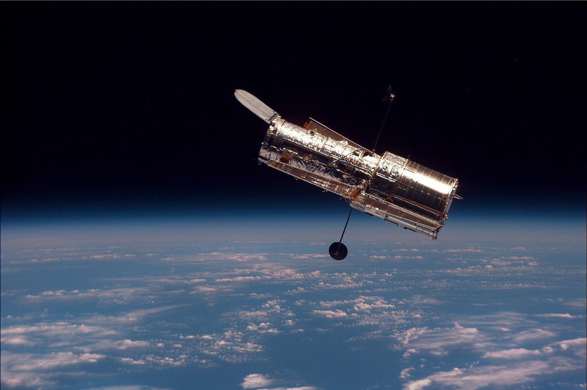

*The Hubble Space Telescope returns to orbit after its second servicing mission in February 1997. Image: NASA (public domain)*

On October 29, 2026, NASA issued a Request for Information asking commercial companies whether they can extend the life of the Hubble Space Telescope. The telescope, orbiting approximately 300 miles (483 km) above Earth, has no propulsion system of its own. Atmospheric drag is slowly pulling it back, and NASA estimates it will re-enter the atmosphere sometime in 2033 to 2034. The RfI seeks ideas for boosting Hubble to a higher orbit, servicing its systems, or performing a controlled re-entry at the end of its mission — and responses are due by November 30, 2026.

## In Brief

- NASA issued the RfI on October 29, 2026, seeking commercial interest in boosting, servicing, or safely deorbiting Hubble; responses are due by 3 p.m. EST on November 30, 2026.
- Hubble has no onboard propulsion. Atmospheric drag is gradually lowering its orbit, with re-entry predicted in the 2033–2034 timeframe.
- The telescope has made more than 1.7 million observations and contributed to over 23,000 peer-reviewed science papers since its launch in April 1990.
- Five Space Shuttle servicing missions maintained and upgraded Hubble between 1993 and 2009. The Shuttle fleet retired in 2011, leaving no existing crewed vehicle capable of reaching Hubble.
- NASA published its 2026 ISAM State of Play the same day — a 368-page document cataloguing current in-space servicing, assembly, and manufacturing capabilities across the industry.
- Administrator Jared Isaacman said the agency owes it to taxpayers and the scientific community to explore "innovative and cost-effective ways to extend the life of an asset already on orbit."

## Why Hubble Is Still Worth Saving

The James Webb Space Telescope, launched in December 2021, operates in infrared wavelengths and observes the universe in a completely different way. The Nancy Grace Roman Space Telescope, [launched on August 30, 2026](/blog/space-tech-2026-08-31/), offers a field of view 100 times wider than Hubble's. Neither replaces Hubble's ultraviolet and visible-light capabilities.

Hubble remains the only telescope in operation that can make high-resolution ultraviolet observations of stars, galaxies, and planetary atmospheres from above Earth's atmosphere. Ultraviolet light is absorbed by the atmosphere, making ground-based UV astronomy impossible. For studying hot stars, active galactic nuclei, and the composition of planetary atmospheres through transit spectroscopy, Hubble's UV instruments are unmatched.

According to [NASA's Hubble overview](https://science.nasa.gov/mission/hubble/overview/about-hubble/), the telescope has made more than 1.7 million observations over its lifetime. Over 23,000 peer-reviewed science papers have been published using its data, and every current astronomy textbook includes contributions from the observatory. NASA Administrator Jared Isaacman noted in the [agency's announcement](https://science.nasa.gov/missions/hubble/nasa-explores-potential-commercial-servicing-for-hubble-telescope/) that "Hubble still has important science ahead of it, and we should be looking at every reasonable opportunity to keep it delivering for as long as possible."

## What the RfI Actually Asks For

The Request for Information outlines three potential mission types:

**Orbit re-boost.** Hubble's altitude is decreasing due to atmospheric drag. A spacecraft could rendezvous with Hubble and use its thrusters to raise the telescope's orbit, buying additional years of operational life. NASA says a mission would need to take place by 2032 at the latest to prevent uncontrolled re-entry.

**Servicing and enhancement.** Beyond simply boosting the orbit, a mission could attempt to repair or replace degraded components, install new instruments, or upgrade Hubble's pointing and communication systems. All five previous servicing missions were conducted by Space Shuttle astronauts who captured Hubble with the Shuttle's robotic arm, replaced gyroscopes, batteries, and science instruments, and released it back into orbit.

**Controlled deorbit or disposal.** If extending Hubble's life proves infeasible, NASA wants options for a safe, controlled atmospheric re-entry or orbital disposal to ensure debris does not threaten people or property on the ground.

The RfI is not a contract solicitation. It is an information-gathering step that allows NASA to understand what commercial capabilities exist before deciding whether to pursue a formal procurement. Nicky Fox, associate administrator for NASA's Science Mission Directorate, said that "commercial industry has rapidly evolved in recent years to offer new capabilities for in-space satellite capture and servicing."

## The Shuttle Era: Five Servicing Missions, 1993–2009

Hubble's servicing history is the foundation for everything the commercial RfI hopes to achieve.

| Mission | Date | Space Shuttle | Key Accomplishments |
|---------|------|--------------|---------------------|
| SM1 | Dec 1993 | Endeavour (STS-61) | Installed COSTAR corrective optics to fix Hubble's flawed primary mirror; replaced solar arrays and gyroscopes |
| SM2 | Feb 1997 | Discovery (STS-82) | Installed STIS and NICMOS instruments; replaced FGS and tape recorder |
| SM3A | Dec 1999 | Discovery (STS-103) | Replaced all six gyroscopes (Hubble had been in safe mode since November); installed new computer |
| SM3B | Mar 2002 | Columbia (STS-109) | Installed ACS camera; replaced solar arrays with smaller, more efficient panels; installed infrared camera cooling system |
| SM4 | May 2009 | Atlantis (STS-125) | Installed COS spectrograph and WFC3 camera; repaired STIS and ACS; replaced batteries, gyroscopes, and fine guidance sensors |

Each mission required astronauts to perform spacewalks lasting six to seven hours, often over five consecutive days. The Shuttle's cargo bay served as a servicing platform. After SM4 in 2009, NASA stated that Hubble was in the best condition of its life.

The Space Shuttle program retired in July 2011. No current crewed vehicle — including SpaceX's Crew Dragon, Boeing's Starliner, or Russia's Soyuz — has a robotic arm or cargo bay capable of capturing and servicing Hubble. This is why NASA is now looking to commercial solutions.

## What Commercial Servicing Technology Can Currently Do

The commercial in-space servicing landscape has advanced significantly since 2020. NASA's 2026 ISAM (In-Space Servicing, Assembly, and Manufacturing) State of Play, [published the same day as the Hubble RfI](https://www.nasa.gov/technology/nasas-isam-state-of-play-the-industry-standard-for-space-servicing-assembly-and-manufacturing/), runs 368 pages and documents hardware that physically exists — not concepts or PowerPoint presentations.

The ISAM State of Play lists capabilities across 11 functional areas, including robotic manipulation, refueling, inspection, and structural assembly. Entry criteria require that hardware exists as ground prototypes or flight demonstrations. Dale Arney, senior team lead for the ISAM Technology Portfolio at NASA Langley, said that the field has "expanded more than linearly since we started" in 2021.

The most relevant existing capability is [Northrop Grumman's Mission Robotic Vehicle (MRV-1)](/blog/space-tech-2026-09-06/), which launched in July 2026 with two robotic arms designed to inspect, repair, and refuel satellites in geosynchronous orbit. MRV-1 carries a Passive Refueling Module — the first refueling interface standard approved by the U.S. Space Force. However, MRV-1 is designed for GEO satellites, not LEO telescopes, and it uses solar-electric propulsion that requires approximately a year to reach its operational orbit.

Several companies are developing LEO servicing capabilities. The key technical challenges for servicing Hubble commercially are:

**Rendezvous and capture.** Hubble was designed with grapple fixtures for the Shuttle's robotic arm. A commercial servicer would need compatible capture mechanisms. Hubble's dimensions — roughly 43 feet (13.2 meters) long with a 7.9-foot (2.4-meter) primary mirror — and its delicate solar arrays and aperture door require careful handling.

**Orbit raising.** A servicer with sufficient propellant could dock with or grapple Hubble and fire its thrusters to raise the orbit. The delta-v required depends on how much altitude needs to be recovered and how much life extension is desired.

**No human spacewalks.** Unlike the Shuttle missions, a commercial servicing mission would likely be fully robotic. No commercial company currently offers spacewalk-based servicing. This limits what can be repaired to tasks performable by robotic arms and tools.

**Hubble was not designed for robotic servicing.** The telescope's bolted panels, connector types, and access hatches were designed for astronaut hands and tools. A robotic mission would need custom end-effectors and possibly new tools designed specifically for Hubble's hardware.

## Why This Matters

The Hubble RfI is a test case for commercial ISAM. If a company can propose a credible mission to boost or service a 36-year-old telescope that was never designed for robotic servicing, it would demonstrate that in-space servicing has moved from experimental to operational.

NASA's [Habitable Worlds Observatory](/blog/nasa-habitable-worlds-observatory-upgradable-space-telescope/) — the planned $11 billion flagship telescope targeting a launch in the late 2040s — is being designed from the start as a modular, robotically serviceable platform. The Hubble RfI is, in part, a way to assess whether the commercial servicing ecosystem can support that kind of long-term orbital infrastructure today, not just in two decades.

The economic argument is straightforward. Hubble cost approximately $4.7 billion to build and launch (in 1990 dollars), and the five Shuttle servicing missions added billions more. A commercial re-boost mission that costs tens of millions of dollars and extends Hubble's life by even three to five years would deliver extraordinary scientific value relative to its cost — especially since no replacement UV-optical space telescope is currently under construction.

## For Product Builders and Technology Teams

The Hubble RfI illustrates a principle that applies beyond space: extending the life of existing infrastructure is often more cost-effective than replacing it, if the servicing technology exists.

For Pakistani technology teams and product builders, the parallel is direct. LearnOSTEAM, Buddy Bot, and RoboSim are hardware-software systems that schools invest in over multiple years. Designing them for modular repair, component replacement, and software updates — rather than treating them as sealed units — extends their useful life and reduces the total cost of ownership for schools. The same thinking that NASA is applying to a telescope in orbit applies to robotics kits in classrooms.

The ISAM State of Play's entry criterion — hardware must physically exist, not just be a concept — is also a useful principle for product teams. A prototype that has been tested under real conditions provides a different kind of confidence than a design document. For STEAM educators teaching robotics and engineering, the gap between a concept and a working prototype is where the most important learning happens.

## What to Watch Next

- **November 30, 2026:** RfI response deadline. NASA will publish a summary of responses after reviewing them.
- **2027:** NASA's MAX POWER expo on November 6–8, 2026, includes a "Nuclear NASA" media gaggle and a Moon Base update — watch for any ISAM announcements during the event.
- **2032:** NASA's stated deadline for a Hubble servicing mission to take place before uncontrolled re-entry becomes likely.
- **2033–2034:** Predicted Hubble re-entry window without intervention.
- **Late 2040s:** Habitable Worlds Observatory launch, designed from the start for robotic in-space servicing.

The RfI is open. Whether any company can propose a credible mission within the November 30 deadline is the immediate question. The answer will tell us whether commercial in-space servicing has matured enough to save a national scientific asset — or whether Hubble's remarkable 36-year mission will end with an uncontrolled re-entry into the Pacific Ocean.

## Sources

- [NASA Explores Potential Commercial Servicing for Hubble Telescope](https://science.nasa.gov/missions/hubble/nasa-explores-potential-commercial-servicing-for-hubble-telescope/) — NASA, October 30, 2026
- [NASA's ISAM State of Play: The Industry Standard for Space Servicing, Assembly, and Manufacturing](https://www.nasa.gov/technology/nasas-isam-state-of-play-the-industry-standard-for-space-servicing-assembly-and-manufacturing/) — NASA, October 29, 2026
- [About Hubble — NASA Science](https://science.nasa.gov/mission/hubble/overview/about-hubble/) — NASA
- [The History of Hubble — NASA Science](https://science.nasa.gov/mission/hubble/overview/the-history-of-hubble/) — NASA
- [Hubble Timeline — NASA Science](https://science.nasa.gov/mission/hubble/overview/hubble-timeline/) — NASA
- [Northrop Grumman's MRV-1: How In-Space Satellite Servicing Could Become Routine](/blog/space-tech-2026-09-06/) — ShamylMansoor.com
- [NASA's Habitable Worlds Observatory: The $11 Billion Telescope Designed to Be Repaired in Space](/blog/nasa-habitable-worlds-observatory-upgradable-space-telescope/) — ShamylMansoor.com
- [NASA's Roman Space Telescope Launch: What It Means for Astronomy and Education](/blog/space-tech-2026-08-31/) — ShamylMansoor.com