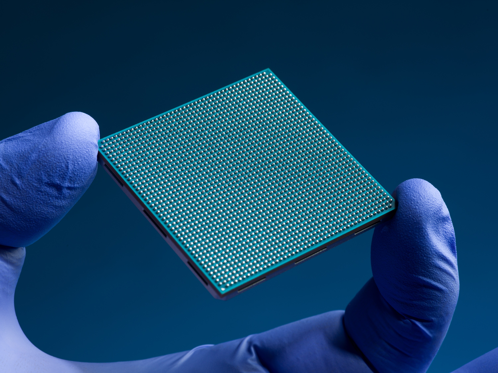

*NASA's High Performance Spaceflight Computing (HPSC) processor, small enough to fit in the palm of a hand. The system-on-a-chip combines 10 RISC-V cores, AI inference pipelines, deterministic Ethernet, and fault-tolerant design in a radiation-hardened package. Image: NASA/JPL-Caltech (public domain)*

NASA is testing a new computer chip that could fundamentally change how spacecraft operate. The High Performance Spaceflight Computing (HPSC) processor, built by Microchip Technology on the RISC-V instruction set architecture, is undergoing radiation, thermal, and shock testing at the Jet Propulsion Laboratory in Southern California. According to NASA, early results show it operating at 500 times the performance of the radiation-hardened chips currently in use — a leap that could enable spacecraft to make autonomous decisions using onboard AI rather than waiting for commands from Earth.

## In Brief

- NASA's HPSC processor is a radiation-hardened, RISC-V-based system-on-a-chip built by Microchip Technology under a $50 million firm-fixed-price contract awarded in August 2022.
- JPL began testing in February 2026; NASA reported the chip operating at 500x the performance of current rad-hard space processors, against an original design target of 100x.
- The chip integrates 10 RISC-V cores (8 application cores using SiFive X280 vector pipelines, plus 2 system controller cores), delivering roughly 2 TOPS of INT8 AI inference and 1 TFLOPS of BF16 throughput.
- A 240 Gb/s Time-Sensitive Networking Ethernet switch built into the chip enables distributed spacecraft computing architectures.
- Dual-Core Lockstep mode, ECC memory, and RISC-V WorldGuard isolation allow mixed-criticality workloads — flight control and AI inference can run on the same chip without interfering.
- Once certified, HPSC will be incorporated into Earth orbiters, planetary rovers, crewed habitats, and deep-space missions.

## The Problem: Space Computers Are Stuck in the 1990s

Most NASA spacecraft still fly with processors designed decades ago. The RAD750, manufactured by BAE Systems and based on the IBM PowerPC 750 architecture, runs at 110 to 200 MHz and delivers around 266 MIPS. It was first released in 2001, and its first flight was in 2005. According to Wikipedia, it is manufactured using 250 or 150 nm photolithography — process nodes that were state-of-the-art in the late 1990s.

The reason for this gap is not neglect. It is physics. Standard commercial processors are destroyed by the radiation environment in space. High-energy particles from the Sun and interstellar space cause single-event upsets — bit flips that corrupt data — and total ionizing dose effects that degrade semiconductor performance over time. Extreme temperature swings, from below -55°C to above 125°C, further stress electronics. Every component destined for spaceflight must be radiation-hardened, qualified through exhaustive testing, and proven reliable over mission durations that can span decades.

The result is a design bottleneck. NASA's current space-qualified computers were "developed almost 30 years ago," Wesley Powell, NASA's principal technologist for advanced avionics, said in a [NASA announcement](https://www.nasa.gov/news-release/nasa-awards-next-generation-spaceflight-computing-processor-contract/). They can handle command, control, and telemetry. They cannot efficiently run AI inference, sensor fusion, autonomous navigation, or high-rate science data triage.

## How HPSC Works: A RISC-V System-on-a-Chip for Space

The HPSC processor is a complete computer on a single chip. According to [NASA's JPL](https://www.nasa.gov/technology/hello-universe-nasas-next-gen-space-processor-undergoes-testing/), it fits in the palm of a hand and includes central processing units, computational offloads, networking units, memory controllers, and input/output interfaces — all in one package.

### Architecture: 10 RISC-V Cores with Vector Pipelines

The chip uses a cache-coherent 64-bit RISC-V architecture with 10 cores:

- **8 application cores** arranged as two SiFive X280 quad-core complexes, each with 512-bit RISC-V vector pipelines. These vector units are the primary engine for AI inference and scientific computing.
- **2 system controller cores** that manage fault recovery, power states, mission-mode transitions, and safe-state procedures.

NASA and Microchip chose RISC-V vectors instead of a dedicated neural processing unit because spacecraft impose unusual constraints. A separate accelerator adds software complexity, verification burden, power consumption, and fault-management challenges. By using one instruction set architecture for scalar, signal processing, AI, and scientific workloads, HPSC gives flight software teams a simpler target than a CPU-plus-NPU-plus-FPGA combination.

### Performance: What 500x Actually Means

According to NASA's June 2026 article, early testing shows the processor operating at 500 times the performance of current radiation-hardened chips. The original design target, stated in the 2022 contract announcement, was 100 times the computational capacity of current spaceflight computers.

According to [Jon Peddie Research](https://www.jonpeddie.com/news/nasa-builds-space-grade-ai-compute), the chip delivers:

| Metric | Value |
|--------|-------|
| INT8 AI performance | ~2 TOPS |
| BF16 throughput | ~1 TFLOPS |
| General compute | ~26,000 DMIPS |
| CoreMark | ~46,000 |
| Clock speed | Up to 1.0 GHz |
| Memory bandwidth | 51.2 GB/s (dual DDR4) |
| Networking | 240 Gb/s TSN Ethernet (16 ports) |

These numbers do not compete with terrestrial AI accelerators. They do not need to. The relevant comparison is against the RAD750's 266 MIPS at 200 MHz. HPSC represents a generational leap in space computing — one that brings spacecraft processors closer to the performance of a modern embedded system than a 1990s workstation.

### Fault Tolerance: Computing When Everything Is Trying to Kill You

Radiation-hardened design is not just about surviving radiation. It is about detecting and recovering from errors in real time. HPSC implements multiple layers of protection:

- **Dual-Core Lockstep (DCLS):** Application cores can run in pairs, with one core executing as the main and another as a shadow. The system compares outputs cycle by cycle. If a mismatch appears — say, from a cosmic ray flipping a bit — the system stops the operation before corrupted data reaches memory and alerts the system controller.
- **ECC and EDAC:** Error correction codes and error detection and correction on all memory paths, with memory scrubbing to catch accumulated errors.
- **Modular redundancy and fault containment:** The architecture addresses total ionizing dose, single-event upsets, transients, latch-up, and functional interrupts.
- **RISC-V WorldGuard and virtualization:** Teams can partition cores, memory, and I/O into isolated domains. One partition can run VxWorks or RTEMS for flight-critical control. Another can run Linux with AI frameworks for science analysis. A hypervisor enforces separation.

This mixed-criticality model matters. It means a spacecraft can run deterministic flight software and experimental AI code on the same chip without the AI code interfering with safety-critical operations.

### Power Management: 70+ Power Islands

Spacecraft operate under strict power constraints — solar panels, batteries, and thermal limits all bound the energy budget. HPSC includes more than 70 software-controlled power islands, clock gating, dynamic clock control, and sleep modes. During a low-power cruise phase, software can shut down application cores and let the chip operate mainly as a deterministic Ethernet switch. During entry, descent, and landing, more vector compute can activate. During a science pass, the chip can prioritize instrument ingest and inference.

This flexibility mirrors a problem that anyone building battery-powered embedded systems faces: how to deliver peak performance when needed without exceeding the average power budget. For a Mars rover, that trade-off is measured in watts that directly determine how far the rover can drive and how many science measurements it can take.

## Why Onboard AI Matters: The Latency Problem

The strongest argument for HPSC is not speed. It is distance.

When the Curiosity rover drills a rock on Mars, the data takes about 5 to 20 minutes to reach Earth, depending on planetary alignment. A ground operator then analyzes the data, decides what to do next, and sends commands back — another 5 to 20 minutes. A single decision cycle can take 40 minutes or more. For a rover like Perseverance, which has some autonomous navigation capability, the bottleneck is the onboard processor's ability to interpret sensor data in real time.

For outer solar system missions, the problem is worse. A spacecraft near Jupiter faces round-trip communication delays of over an hour. Near Saturn, delays exceed two hours. Mission controllers cannot joystick a lander through a descent sequence at those latencies. The spacecraft must make its own decisions.

HPSC moves decision-making closer to the instrument. According to NASA, a lander can classify terrain during descent. A rover can rank science targets before it spends energy driving to them. An orbiter can filter sensor data before it fills the constrained downlink capacity. A spacecraft can manage local hazards without waiting for ground operators.

NASA's JPL is already testing this scenario. According to the NASA article, engineers are using "high-fidelity landing scenarios from real NASA missions that would typically require power-intensive hardware to process huge volumes of landing-sensor data."

## The Software Stack: From TensorFlow to Spaceflight

One of HPSC's most significant design choices is its software compatibility. The chip supports TensorFlow, XNNPACK, OpenXLA, LLVM, OpenCL, and standard RISC-V toolchains. Developers can build and validate AI models on desktop machines, then port code into a mission environment.

This matters because space software has historically required specialized ports, custom DSP flows, and conservative processor assumptions. HPSC gives software developers a modern vector target, familiar AI libraries, Linux support, real-time OS support, and deterministic I/O. The programming model looks much closer to terrestrial embedded AI than previous rad-hard platforms allowed.

For organizations building [educational robotics platforms](/projects/learnosteam) or edge AI systems, this convergence is worth noting. The same open-source AI frameworks that run on a Raspberry Pi or a Jetson Nano can, in principle, run on a radiation-hardened spacecraft processor. The qualification and verification requirements are dramatically different, but the developer experience is converging.

## What This Means for Pakistan, Educators, and Technology Builders

### For STEAM Educators

HPSC is a concrete example of why open architecture matters. RISC-V is an open instruction set — anyone can implement it without licensing fees. NASA's choice of RISC-V for its most advanced space processor validates a model where the architecture is open and the implementation is specialized. For educators teaching [STEAM concepts through hands-on robotics](/projects/buddy-bot), the RISC-V ecosystem offers a path from classroom hardware to space-grade silicon using the same fundamental instruction set. Students who learn RISC-V today are learning the same ISA that will guide NASA's next generation of autonomous spacecraft.

### For Pakistani Technology Teams

Pakistan's space program, SUPARCO, has accelerated satellite development in recent years, launching multiple Earth observation satellites through partnerships with China. The country's first astronaut is scheduled to fly to China's Tiangong space station aboard [Shenzhou-24 on November 25, 2026](/blog/pakistan-first-astronaut-tiangong-space-station/). But Pakistan does not currently design its own radiation-hardened processors.

The HPSC model — where a space agency funds commercial development of an open-architecture chip that the manufacturer can also sell to other markets — offers a template. Pakistan's [INSPIRE semiconductor program](/blog/pakistan-semiconductor-inspire-program-2026/) is building human capital in chip design. A future step could involve domestic teams designing specialized processors for satellites or edge computing applications using RISC-V, leveraging the open ISA to avoid licensing barriers while focusing on domain-specific radiation tolerance and reliability.

### For Product Builders

The design patterns in HPSC are relevant beyond space. Anyone building autonomous systems that must operate without cloud connectivity — agricultural sensors, mining robots, maritime drones, remote infrastructure monitors — faces versions of the same trade-offs: local inference under power, reliability, and latency constraints. HPSC's approach of combining vector pipelines for AI, deterministic networking for real-time communication, mixed-criticality isolation for safety, and granular power management is a reference architecture for edge AI in harsh environments.

## Product Builder's Perspective

From a product-building perspective, HPSC demonstrates three principles that apply to any hardware-software system designed for autonomous operation:

**1. Architect for the constraint, not the benchmark.** HPSC does not chase data-center throughput. It targets the specific problem of running useful AI workloads under power, radiation, and reliability constraints. The 2 TOPS number is modest by terrestrial standards, but it is transformative compared to the RAD750's 266 MIPS. The right question is not "how fast?" but "fast enough for what?"

**2. Reduce the software gap.** The biggest barrier to spacecraft autonomy is not hardware capability. It is the cost of writing, testing, and qualifying flight software. By supporting standard AI frameworks and RISC-V toolchains, HPSC reduces the distance between prototyping and deployment. The same principle applies to any embedded AI product: the closer your development environment is to your deployment environment, the faster you can iterate.

**3. Mix criticality without mixing risk.** The ability to run flight-critical control and experimental AI on the same chip — isolated by hardware virtualization and WorldGuard — is a design pattern that scales. In educational robotics, we face a simpler version of this: ensuring that a student's experimental code does not crash the safety-critical subsystems of a robot. The principle is the same. Isolation by architecture, not by hope.

## What to Watch Next

- **HPSC certification and first flight assignment:** JPL testing began in February 2026 and will continue for several months. Watch for NASA's certification announcement and the first mission to adopt the processor.
- **Microchip's PIC64-HPSC commercialization:** Microchip is productizing the architecture as PIC64-HPSC for commercial space, defense, aviation, and high-reliability edge markets. The commercial availability of radiation-hardened RISC-V processors could expand the supplier base for satellite and aerospace computing.
- **RISC-V adoption across the space industry:** HPSC is not the only RISC-V space project. The architecture is gaining traction in European space programs and commercial satellite constellations. If RISC-V becomes the de facto standard for space computing, it will follow the same adoption pattern as Linux in servers — open foundation, specialized implementations, broad ecosystem.
- **Pakistan's semiconductor trajectory:** The INSPIRE program is building design expertise. Whether that expertise eventually extends to radiation-hardened or aerospace-grade chip design will depend on investment, industry partnerships, and demand from SUPARCO and the broader defense sector.

## Conclusion

NASA's HPSC processor is not just a faster space chip. It is a rethinking of how spacecraft compute — from ground-controlled telemetry relays to autonomous systems that can sense, decide, and act at the point of observation. The choice of RISC-V, the integration of AI-capable vector pipelines, and the mixed-criticality architecture together create a platform that could shape the next two decades of space exploration. For anyone building autonomous systems, edge AI products, or open-architecture hardware, the design choices embedded in HPSC are worth studying.

The chip that fits in the palm of a hand may be the one that finally lets spacecraft think for themselves.

---

**Sources:**
- [NASA JPL — "Hello Universe: NASA's Next-Gen Space Processor Undergoes Testing"](https://www.nasa.gov/technology/hello-universe-nasas-next-gen-space-processor-undergoes-testing/) (published May 12, 2026; last updated June 22, 2026)
- [NASA — "NASA Awards Next-Generation Spaceflight Computing Processor Contract"](https://www.nasa.gov/news-release/nasa-awards-next-generation-spaceflight-computing-processor-contract/) (August 15, 2022)
- [Jon Peddie Research — "NASA builds space-grade AI compute"](https://www.jonpeddie.com/news/nasa-builds-space-grade-ai-compute) (May 20, 2026)
- [Gizmodo — "NASA's Next-Gen Processor Is 500 Times More Powerful Than Current Space Chips"](https://www.gizmodo.com/nasas-next-gen-processor-is-500-times-more-powerful-than-current-space-chips-2001647016) (May 14, 2026)
- [Wikipedia — RAD750](https://en.wikipedia.org/wiki/RAD750)
