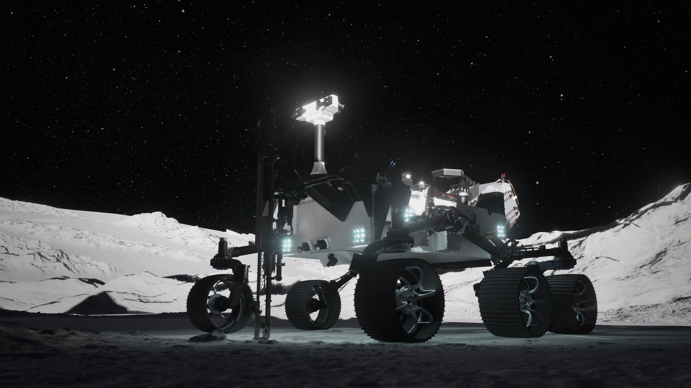

*Artist's rendering of NASA's PROMISE (Polar Rover for Observation, Mapping, and In-Situ Exploration) on the lunar South Pole. The rover is built from spare flight components and engineering test models from the Curiosity and Perseverance Mars rover programs. Image: NASA (public domain)*

On November 7, 2026, at the MAX POWER aerospace expo at Kennedy Space Center, NASA announced the most significant expansion of its lunar exploration program since the Artemis architecture was revised earlier this year. The announcements include a $10 billion CLPS 2 contract covering eight companies for lunar cargo delivery, a nuclear-powered rover called PROMISE built from repurposed Mars rover hardware, $1.3 billion in transportation task orders, and infrastructure components for power and communications on the lunar surface. Together, these awards sketch the outlines of a permanent outpost at the Moon's South Pole — one built not by NASA alone, but by a network of commercial partners.

## In Brief

- NASA selected eight companies for CLPS 2, a 10-year indefinite-delivery/indefinite-quantity contract with a maximum value of $10 billion: Blue Origin, Firefly Aerospace, Intuitive Machines, ispace-U.S., Lockheed Martin Space, Northrop Grumman Space Systems, SpaceX, and Voyager Technologies.
- The agency is moving forward with PROMISE (Polar Rover for Observation, Mapping, and In-Situ Exploration), a nuclear-powered, six-wheeled rover built by JPL from spare Curiosity and Perseverance Mars rover components, targeting launch in late 2028 for an 18-month mission.
- Blue Origin was awarded a $94 million base contract (with a $140 million option period) to deliver PROMISE to the lunar South Pole using its Mark 1 lander.
- Six VADR task orders worth approximately $1.3 billion combined were awarded to Arrow Science and Technology, Blue Origin, and Impulse Space for orbital transfer and lunar delivery demonstrations.
- SpaceX was selected for a cislunar communications deployment demonstration using Starship to launch communications satellites in 2028.
- NASA also announced the miniCAST (Mini-Communications and Solar Tower) infrastructure program with awards to Honeybee Robotics, Redwire, and Yank Technologies for power generation, storage, and wireless transfer.

## CLPS 2: A $10 Billion Cargo Pipeline to the Moon

The Commercial Lunar Payload Services (CLPS) program is NASA's framework for contracting private companies to deliver science instruments, technology demonstrations, and infrastructure to the lunar surface. The original CLPS 1.0 contract, awarded in 2018, had a ceiling of $2.6 billion. NASA has now increased that to $4.2 billion to support initial Moon Base operations through November 2028, with deliveries continuing through November 2033.

CLPS 2 expands the program dramatically. According to [NASA's announcement](https://www.nasa.gov/news-release/nasa-awards-moon-base-transportation-technology-science-projects/), the new contract is a 10-year, multiple-award, indefinite-delivery/indefinite-quantity master contract with a combined maximum value of $10 billion. The eight selected companies will compete for individual task orders to build, operate, and deliver landers carrying NASA payloads to the Moon.

The shift from CLPS 1.0 to CLPS 2 reflects a change in scale. The first phase delivered small science payloads — tens of kilograms per mission. CLPS 2 is designed for cargo loads of up to six metric tons, according to Moon Base Program manager Carlos García-Galán, who spoke at the announcement event. That is the difference between sending an instrument package and sending a habitat module.

### The Eight CLPS 2 Companies

| Company | Notable Lunar Programs |
|---------|----------------------|
| Blue Origin | Blue Moon Mark 1 lander (PROMISE delivery); Mark 2 for crewed missions |
| Firefly Aerospace | Blue Ghost lander (first CLPS delivery in 2025) |
| Intuitive Machines | Nova-C lander (first commercial Moon landing in 2024); lunar communications satellites |
| ispace-U.S. | Series 2 lander; commercial lunar delivery services |
| Lockheed Martin Space | Major aerospace prime; extensive satellite and deep-space experience |
| Northrop Grumman Space Systems | MRV-1 satellite servicing vehicle; Cygnus cargo spacecraft |
| SpaceX | Starship lunar lander variant for Artemis; Falcon 9 launch services |
| Voyager Technologies | Launch and space services aggregator |

The list includes both companies with proven lunar flight heritage (Intuitive Machines achieved the first commercial Moon landing in 2024) and major primes bringing deep-space systems experience. The competitive structure means NASA can assign specific delivery tasks to whichever company offers the best combination of cost, schedule, and capability — a procurement model that mirrors how the agency buys launch services for Earth-orbit satellites.

## PROMISE: A Mars Rover Goes to the Moon

The most technically interesting announcement is PROMISE. According to [Scientific American](https://www.scientificamerican.com/article/nasa-reveals-new-lunar-rover-promise-to-launch-to-moon-in-2028/), the rover will be built by NASA's Jet Propulsion Laboratory (JPL) using a combination of spare flight components and engineering test models from the Curiosity and Perseverance Mars rover programs.

This is not a new design. It is, in essence, a Mars rover repurposed for the Moon. The six-wheeled chassis, the autonomous navigation software, the overall systems architecture — all are proven hardware that has survived years of operation in one of the most hostile environments in the solar system. JPL has assessed the hardware's compatibility with lunar conditions and determined it can tolerate the harsh environment near the Moon's South Pole.

PROMISE will carry:

- **A drill** capable of extracting regolith from approximately 3 feet (1 meter) below the surface to characterize ice and other resources
- **Spectrometers** for analyzing the chemical composition of surface material
- **Temperature and radiation sensors** to characterize the lunar environment for future human operations
- **Visible-light cameras** for navigation and surface documentation
- **NASA's High Performance Spaceflight Computing** system — a next-generation, radiation-tolerant computing platform
- **Advanced autonomy sensors and algorithms** for independent navigation and decision-making

The rover is nuclear-powered, which means it can operate during the two-week lunar night and inside permanently shadowed regions where solar panels cannot generate electricity. This is the same advantage that made radioisotope thermoelectric generators (RTGs) essential for Mars rovers — and it is essential for the lunar South Pole, where permanently shadowed craters are thought to contain water ice deposits that represent the most valuable resource on the Moon.

NASA's associate administrator for science, Nicky Fox, said at the event that PROMISE will "serve as a scout for Moon Base operations" while also "prospecting for resources near the lunar south pole." The mission's project scientist is James Keane, a planetary scientist at JPL.

### The Cost Question

According to [SpaceNews](https://spacenews.com/sending-repurposed-mars-rover-to-the-moon-could-cost-more-than-1-billion/), converting an engineering model of the Perseverance Mars rover into a flight-ready lunar rover could cost more than $1 billion. NASA Administrator Jared Isaacman has reportedly pushed back against that estimate. The Blue Origin delivery contract — $94 million base, with a $140 million option — covers only the lander, not the rover itself.

The cost debate highlights a tension in the repurposing approach. Reusing Mars rover hardware saves design and development time, but the components still need to be tested, qualified, and integrated into a new spacecraft for a different destination. The economic case depends on how much of the Mars rover's non-recurring engineering cost can genuinely be amortized versus how much new work is required.

## The Transportation Layer: $1.3 Billion in VADR Task Orders

Moving cargo between Earth orbit and the lunar surface requires more than just landers. NASA awarded six task orders under its Venture-Class Acquisition of Dedicated and Rideshare (VADR) launch services contract, with a combined value of approximately $1.3 billion, to three companies: Arrow Science and Technology, Blue Origin, and Impulse Space.

The task orders cover three mission types:

**Orbital transfer and navigation testing.** These missions will verify that communication and navigation methods work during the journey from Earth orbit to the Moon. They include delivering the CAPSTONE 02 spacecraft to deep space to test proximity maneuvers and communications around the Moon. [Impulse Space](https://www.impulsespace.com/) — a company founded by former SpaceX CTO Tom Müller — was awarded two task orders for in-space transportation.

**Lunar surface survey using MoonFall drones.** NASA will deploy highly mobile drones designed to scout areas of the lunar South Pole before astronauts arrive. These "MoonFall" drones are designed to hop around the surface, accessing terrain beyond the reach of traditional rovers. Launch vehicles for these missions include Blue Origin's New Glenn, Relativity Space's Terran R, and SpaceX's Falcon 9.

**Cislunar orbit demonstrations.** These missions will test navigation technologies and demonstrate commercial orbital transfer capabilities in multiple orbits between Earth and the Moon, increasing the amount of cargo that future landers can deliver.

SpaceX was separately selected for a Cislunar Communications Deployment Demonstration, launching communications satellites aboard a Starship to cislunar space in 2028. This could eventually on-ramp SpaceX's Starlink into a commercial services contract for Moon Base communications — a significant expansion of Starlink's operational domain.

## miniCAST: Power and Communications on the Surface

A Moon Base needs power and communications. NASA announced the miniCAST (Mini-Communications and Solar Tower) program, with awards to three companies:

- **Honeybee Robotics** (a Blue Origin company) for energy storage capability
- **Redwire** for power generation
- **Yank Technologies** for wireless power transfer

miniCAST will combine solar arrays, batteries, and wireless power-transfer hardware to provide electricity and communications for future surface operations. Engineers at NASA's Marshall Space Flight Center in Huntsville, Alabama, will assemble and test the systems. NASA expects a separate solicitation for fully integrated power systems in early 2027.

The inclusion of wireless power transfer is notable. It means NASA is exploring the ability to beam power from a central generating station to remote assets — rovers, instruments, habitats — without physical cable connections. This is a capability that could fundamentally change how lunar surface infrastructure is designed.

## Why the Lunar South Pole Matters

All of these investments point to a single location: the lunar South Pole. The region is scientifically and economically unique because of its permanently shadowed craters, which have preserved water ice over billions of years. Water is the single most valuable resource for sustained lunar operations — not just for drinking and life support, but because it can be split into hydrogen and oxygen for rocket propellant.

China's [Chang'e-7 mission](/blog/space-tech-2026-08-23/), which launched in August 2026, is also targeting the lunar South Pole with a hopper spacecraft designed to drill into shadowed craters. The parallel efforts by NASA and China's lunar program reflect a shared assessment that the South Pole is the most strategically important location on the Moon.

For a broader comparison, NASA's [Habitable Worlds Observatory](/blog/nasa-habitable-worlds-observatory-upgradable-space-telescope/) represents the agency's long-term astrophysics ambition. The Moon Base represents its near-term exploration and infrastructure ambition. Both programs share a design philosophy: build for extensibility, use commercial partnerships, and design for maintenance rather than disposal.

## What This Means for Pakistan and Emerging Space Programs

For countries with developing space programs, NASA's Moon Base build-out offers several lessons.

**Commercial partnerships compress timelines.** NASA is not building its own lunar landers. It is buying delivery services from private companies, competing them against each other, and scaling its procurement as the market matures. This model — which NASA pioneered with commercial cargo and crew services to the International Space Station — is now being applied to the Moon. For Pakistan's space agency SUPARCO, which is expanding its satellite capabilities, the lesson is that a national space program does not need to build every component in-house. Strategic procurement from a growing commercial market can accelerate capability development.

**The economic case for lunar resources changes the calculus.** If water ice can be extracted and processed into propellant on the Moon, the cost of deep-space missions drops dramatically. A spacecraft heading to Mars could refuel in lunar orbit rather than carrying all its propellant from Earth. This creates a strategic interest in lunar surface access that goes beyond science — it is about who controls the infrastructure for interplanetary travel.

For Pakistani technology teams and educators, the Moon Base program is a rich teaching context. The challenges of lunar surface operations — autonomous navigation, power management in extreme environments, resource prospecting, wireless power transfer — map onto concepts that [LearnOSTEAM](/projects/learnosteam/) and [RoboSim](/projects/robosim/) already teach at a simplified level. A nuclear-powered rover that drills into lunar ice to characterize resources is an extreme version of the same sensor-based exploration and autonomous decision-making that students learn through [educational robotics platforms](/projects/buddy-bot/).

## Product Builder's Perspective

From a product-building perspective, the Moon Base announcements illustrate three principles that apply to any complex technology program.

**Reuse proven hardware wherever possible.** PROMISE is not a new rover design. It is a Mars rover adapted for a new mission. The non-recurring engineering cost of developing a rover from scratch — the chassis, the navigation system, the autonomous software — was already paid for by the Mars program. JPL is amortizing that investment across a second mission to a different destination. In product development, this is the equivalent of building a new feature on top of an existing platform rather than starting from zero.

**Build the ecosystem, not just the product.** NASA is not buying a single lander or a single rover. It is building a transportation network — launch services, orbital transfer vehicles, landers, surface infrastructure, communications — with multiple commercial providers at each layer. This creates redundancy, competition, and the ability to scale individual layers independently. For technology product teams, the parallel is building a platform with composable services rather than a monolithic product where every capability must be developed in-house.

**Infrastructure before outcomes.** miniCAST is not a science instrument. It is power and communications infrastructure. NASA is investing in the boring, foundational systems that make everything else possible — the same way a technology company invests in DevOps, observability, and data pipelines before building the features that customers see. The Moon Base program is making these investments early, before the first human astronauts arrive.

## What to Watch Next

- **CLPS 2 task order awards**: The first individual delivery missions under the CLPS 2 contract will reveal which companies NASA trusts with the earliest Moon Base cargo runs.
- **PROMISE rover development milestones**: Watch for JPL announcements about integration and testing progress, particularly whether the cost stays near Isaacman's estimate or approaches the $1 billion figure reported by SpaceNews.
- **Blue Origin Mark 1 lander performance**: Blue Origin's Mark 1 lander is the designated delivery vehicle for PROMISE. Its first lunar landing will be a critical test of Blue Origin's lunar capability.
- **Artemis III in 2027**: The crewed Earth-orbit test of both Blue Origin's and SpaceX's landers, requiring three coordinated rocket launches — New Glenn, Starship, and SLS — is the precursor to the first Moon Base crewed missions in 2028.
- **miniCAST solicitation for integrated power systems in early 2027**: This will reveal whether NASA's surface infrastructure timeline is on track.
- **China's Chang'e-7 results**: If China's hopper successfully extracts and analyzes water ice from a permanently shadowed crater, it will validate the resource case that both programs are betting on.

## Conclusion

NASA's November 7 announcements represent the transition from individual lunar missions to a sustained lunar infrastructure program. The $10 billion CLPS 2 contract, the PROMISE nuclear rover, the VADR transportation task orders, and the miniCAST power system are not isolated projects — they are interlocking pieces of a logistics network designed to keep humans on the Moon for years, not days.

For anyone building technology products, the Moon Base program is a case study in how to deconstruct an ambitious goal into a portfolio of commercial contracts, each with clear deliverables and competition. Whether the destination is the lunar South Pole or a new product market, the principles are the same: reuse what works, build the ecosystem, and invest in infrastructure before the outcomes.

The question is no longer whether NASA will build a Moon Base. It is which companies will deliver the pieces — and whether the first permanent lunar outpost will be American, Chinese, or both.

## Sources

- [NASA Awards Moon Base Transportation, Technology, Science Projects](https://www.nasa.gov/news-release/nasa-awards-moon-base-transportation-technology-science-projects/) — NASA, November 7, 2026
- [NASA's Moon Base Program Page](https://www.nasa.gov/moonbase/)
- [NASA Images and Media Usage Guidelines](https://www.nasa.gov/nasa-brand-center/images-and-media/)
- [NASA reveals new lunar rover, PROMISE, to launch to moon in 2028](https://www.scientificamerican.com/article/nasa-reveals-new-lunar-rover-promise-to-launch-to-moon-in-2028/) — Scientific American, November 7, 2026
- [Sending repurposed Mars rover to the moon could cost more than $1 billion](https://spacenews.com/sending-repurposed-mars-rover-to-the-moon-could-cost-more-than-1-billion/) — SpaceNews, July 31, 2026
- [NASA says Artemis program adjustments improve shot at 2028 moon landing](https://www.cbsnews.com/news/nasa-says-artemis-program-adjustments-improve-shot-at-2028-moon-landing/) — CBS News, October 23, 2026
- [China's Chang'e-7 Lunar South Pole Mission](/blog/space-tech-2026-08-23/) — ShamylMansoor.com
- [NASA's Habitable Worlds Observatory](/blog/nasa-habitable-worlds-observatory-upgradable-space-telescope/) — ShamylMansoor.com
- [NASA's Roman Space Telescope Launch](/blog/space-tech-2026-08-31/) — ShamylMansoor.com
