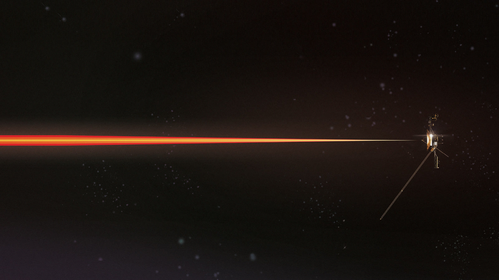

*Voyager 1, depicted in this artist's concept, reached one light-day from Earth on November 18, 2026 — after more than 49 years of constant travel. The spacecraft is now so far that its radio signals take 24 hours to reach Earth. Image: NASA/JPL-Caltech (public domain)*

On November 18, 2026, at 2:16 a.m. Pacific time, NASA's Voyager 1 became the first human-made object to travel one light-day from Earth. A light-day is the distance light travels in 24 hours — approximately 16.1 billion miles (25.9 billion kilometers). The spacecraft achieved the milestone after 49 years of continuous flight, and the confirmation reached Earth a full day later, when Voyager's radio signal finally arrived at the Jet Propulsion Laboratory in Southern California.

## In Brief

- Voyager 1 crossed the one light-day distance mark on November 18, 2026, at 2:16 a.m. PST — 16.1 billion miles (25.9 billion km) from Earth.
- A light-day is the distance light travels in 24 hours; Voyager's radio signals now take a full day to reach Earth and a full day for commands to return.
- The spacecraft launched on September 5, 1977, and has been operating for over 49 years — far beyond its original 3-year planetary mission.
- Engineers have kept Voyager alive by shutting down non-essential instruments, substituting higher-power components with lower-power alternatives, and managing a nuclear battery that loses about 4 watts of output each year.
- Voyager 1 entered interstellar space in August 2012 when it crossed the heliopause — the boundary where the Sun's magnetic influence gives way to the interstellar medium.
- Three of the original 11 science instruments remain active, and NASA expects both Voyager probes to operate until at least their 50th launch anniversaries in summer 2027.

## What One Light-Day Actually Means

Scientists measure cosmic distances in light-time because it conveys both distance and delay simultaneously. Light travels at roughly 186,000 miles (299,000 kilometers) per second in a vacuum. Sunlight reaches the Moon in about 1.3 seconds, reaches Neptune in about four hours, and now reaches Voyager 1 in about 20 hours.

A light-day — 24 hours of light travel — equals approximately 16.1 billion miles. For context, a light-year is 5.88 trillion miles, meaning Voyager 1 has traveled roughly 1/365th of a light-year. That may sound modest until you consider that no other object humanity has ever built comes close. The second-farthest spacecraft is Voyager 2, which trails its twin by several light-hours.

The practical implication is communication latency. Every command sent to Voyager 1 takes 24 hours to arrive. Every response takes another 24 hours to return. A single round-trip interaction takes two days. Mission controllers at JPL send commands weekly and listen daily, but they cannot joystick this spacecraft. Every instruction must be right the first time, because correction takes 48 hours.

## How Engineers Have Kept Voyager Alive for 49 Years

The Voyager spacecraft were designed for a 3-year mission to Jupiter and Saturn. Nobody in 1977 expected them to still be operating in 2026. The fact that they are is not luck. It is the result of deliberate engineering choices made during design and decades of creative problem-solving during operations.

### The Power Problem: Managing a Depleting Nuclear Battery

Each Voyager spacecraft is powered by a radioisotope thermoelectric generator (RTG) — essentially a nuclear battery that converts heat from decaying plutonium-238 into electricity. The plutonium supply continually depletes, and each spacecraft loses about 4 watts of generating capacity per year. At launch in 1977, Voyager 1's RTG produced approximately 470 watts. By 2026, output has declined to roughly 220 watts — less than half the original capacity.

To keep the spacecraft functional, engineers have progressively shut down systems. They turned off cameras in 1990 after Voyager 1 took the famous "Pale Blue Dot" photograph of Earth from the edge of the solar system. They have disabled heaters, switched off non-essential instruments, and rerouted power to the most critical subsystems. Three of the original 11 science instruments on each probe remain active.

Earlier in 2026, the Voyager team executed a particularly risky maneuver: they turned off three devices on Voyager 1 and substituted them with three lower-power alternatives. According to NASA, the swap was not without risk — aging hardware can fail when power states change — but it was necessary to extend the spacecraft's operating life. The goal is to keep both probes' remaining science instruments running until at least their 50th launch anniversaries in summer 2027.

### The Thruster Problem: Clogged Lines and Creative Workarounds

In 2017, Voyager 1's primary attitude-control thrusters began showing signs of degradation. These thrusters keep the spacecraft's antenna pointed toward Earth — a function so critical that losing it would end the mission. Engineers discovered that the primary thrusters' fuel lines were becoming clogged with silicone dioxide residue from the spacecraft's rubber diaphragm fuel pump.

The solution required reaching back into 37-year-old documentation. Engineers found that Voyager 1 carried a set of trajectory correction maneuver thrusters that had last been used during the Jupiter flyby in 1979. After testing whether these dormant thrusters could still fire — a command that took 19 hours to reach the spacecraft and 19 hours to confirm — they successfully switched to the backup thrusters in November 2017.

This is not an isolated example. The Voyager team has dealt with a malfunctioning computer, a stuck instrument, and the gradual failure of multiple subsystems, each time finding a workaround using hardware that was never intended as a primary backup but happened to be available.

### The Communication Problem: The Deep Space Network

Communicating with a spacecraft that is a full light-day away requires infrastructure on a planetary scale. NASA's Deep Space Network (DSN) consists of three antenna facilities spaced roughly 120 degrees apart around Earth: Goldstone in California's Mojave Desert, Madrid in Spain, and Canberra in Australia. This arrangement ensures that at least one facility always has a line of sight to any deep-space probe.

The DSN's largest antennas are 70 meters (230 feet) in diameter. Voyager 1's transmitter operates at 23 watts — about the power of a refrigerator light bulb. By the time that signal reaches Earth, it is extraordinarily faint, requiring the full sensitivity of the DSN's largest dishes to detect. As Voyager moves farther away, the signal weakens further, and the time available to listen each day shrinks.

## Why Voyager Still Matters Scientifically

Voyager 1 crossed the heliopause in August 2012, becoming the first spacecraft to enter interstellar space. The heliopause is the boundary where the Sun's solar wind — the stream of charged particles flowing outward from the Sun — is stopped by the pressure of the interstellar medium. Voyager 2 followed in November 2018, taking a different trajectory.

According to Linda Spilker, Voyager project scientist at JPL, one of the biggest surprises is the extent to which the Sun continues to influence interstellar space even beyond the heliopause. "Where does the Sun's influence end and pristine interstellar space begin?" she asked in NASA's announcement. "Perhaps Voyager may endure long enough to answer that question."

The spacecraft's remaining instruments measure magnetic fields, charged particles, and plasma waves — data that cannot be obtained any other way. No other probe is in interstellar space, and none is planned for decades. Every day Voyager operates, it returns data from a region of space humanity has never explored.

## What This Means for Pakistan, Educators, and Technology Builders

### For STEAM Educators

Voyager is one of the most powerful teaching tools in science education. It connects physics (orbital mechanics, gravity assists), chemistry (nuclear decay and RTGs), engineering (redundancy, power management, communications), and computer science (1970s programming still running today) in a single, story-driven package.

For educators using [hands-on robotics platforms](/work/learnosteam/) to teach STEAM concepts, Voyager offers a case study in systems thinking. The spacecraft is not a single device — it is a collection of interdependent subsystems, each with its own constraints, failure modes, and workarounds. Asking students to design a system that must operate for 50 years without maintenance forces them to think about trade-offs between capability, power, reliability, and cost. That is the same thinking required to build a [classroom robot](/work/buddy-bot/) that survives a semester of student use, scaled up by a factor of billions.

### For Pakistani Technology Teams

Pakistan's space program, SUPARCO, has launched Earth observation satellites and is preparing to send its [first astronaut to China's Tiangong space station](/blog/pakistan-first-astronaut-tiangong-space-station/) on November 25, 2026. But Pakistan does not currently operate deep-space probes or interplanetary missions.

Voyager's relevance to Pakistani technology teams is not in deep-space exploration per se. It is in the engineering discipline of building systems that last. Pakistan's [INSPIRE semiconductor program](/blog/pakistan-semiconductor-inspire-program-2026/) is building human capital in chip design. The country's growing satellite program requires electronics that can survive radiation, thermal cycling, and long-duration operation without maintenance. The principles that kept Voyager alive — redundancy at the system level, graceful degradation, conservative power budgets, and documentation that survives personnel turnover — apply directly to any aerospace or remote-infrastructure project.

### For Product Builders

From a product-building perspective, Voyager demonstrates three principles that apply to any system designed for long unattended operation:

**1. Design for graceful degradation, not just for peak performance.** Voyager was not designed to operate at 220 watts. It was designed to operate at 470 watts and then, through a planned sequence of shutdowns and substitutions, to continue providing reduced but still valuable service as power declined. Every long-lived system — whether a satellite, a remote sensor network, or an educational robotics platform deployed across hundreds of schools — needs a degradation plan, not just a performance spec.

**2. Documentation is a survival system.** When the Voyager team needed to fire thrusters that had been dormant for 37 years, they relied on original engineering documentation from the 1970s. If those documents had been lost, the mission would have ended. For any product team, this means that documentation is not a deliverable — it is infrastructure. It must survive as long as the product does.

**3. The team is part of the system.** Voyager's longevity is not just a hardware story. It is a story about institutional knowledge passed across generations of engineers. The people who built Voyager are retired. The people who fly it today learned from those who learned from those who learned from the original designers. For organizations building [complex technology products](/work/learnosteam/), the continuity of engineering knowledge — through documentation, mentorship, and culture — is as critical as the hardware and software itself.

## Product Builder's Perspective

The most striking thing about Voyager 1's light-day milestone is not the distance. It is the time. Forty-nine years of continuous operation for a spacecraft designed in the early 1970s, built with 1970s electronics, and programmed with 1970s software.

In an industry where a product lifecycle of 5 years is considered long, where software updates are pushed weekly, and where hardware is replaced every 2-3 years, Voyager represents a completely different engineering philosophy. Every decision made in 1977 — every component selection, every line of code, every redundancy choice — is still in effect today. There are no patches. There are no hardware revisions. There are no recalls. The spacecraft that is now a light-day away is exactly the spacecraft that left Earth in 1977, minus the instruments that have been shut down and the power that has been consumed.

This does not mean we should all build for 50-year lifespans. Most products should not. But it does mean that the discipline of thinking about what happens when power runs low, when components fail, when communication is delayed, and when the original team is gone — that discipline has value far beyond space exploration. It is the discipline of building things that work when you are not there to fix them.

## What to Watch Next

- **Voyager 50th anniversary (summer 2027):** Both probes will reach their 50th launch anniversaries. NASA's goal is to keep their remaining instruments operating until at least that milestone. Watch for announcements about further power-saving measures.
- **Science and engineering data anomaly:** Voyager 1 has not transmitted science and engineering data since November 14, 2026, though its carrier signal remains active. JPL engineers are analyzing the issue. This kind of anomaly has occurred before and has been resolved, but each one is a reminder that the spacecraft's remaining lifetime is finite.
- **Signal loss timeline:** As RTG output continues to decline, eventually the spacecraft will not have enough power to transmit a detectable signal. NASA has not published a specific date, but estimates suggest the 2030s as a likely window for final contact.
- **Future interstellar missions:** No successor to Voyager is currently funded or under construction. Concepts for a dedicated interstellar probe have been studied, but none has received a mission commitment. For the foreseeable future, the Voyagers are humanity's only direct samplers of the interstellar medium.

## Conclusion

Voyager 1's light-day milestone is a moment worth pausing on. Not because the spacecraft set another distance record — it has been setting those for decades — but because it represents something rare in engineering: a system that has exceeded every expectation of its designers by a factor of more than 15, and that continues to return scientific data from a region of space no other instrument can reach.

The spacecraft will eventually fall silent. Its radioisotope generator will drop below the threshold needed to power the transmitter. The Deep Space Network will stop detecting its faint 23-watt signal. But Voyager 1 will keep traveling, silently, at 38,000 mph through the interstellar medium — humanity's ambassador to the galaxy, as Suzanne Dodd, Voyager project manager at JPL, described it. "One day in the future, when it can no longer communicate with Earth, Voyager 1 will become humanity's silent ambassador to the stars."

For now, it still calls home. It just takes a day.

---

**Sources:**
- [NASA — "NASA's Voyager 1 Makes History Reaching One Light-Day From Earth"](https://www.nasa.gov/news-release/nasas-voyager-1-makes-history-reaching-one-light-day-from-earth/) (published November 19, 2026)
- [NASA Science — Voyager Mission Page](https://science.nasa.gov/mission/voyager/)
- [PBS — "Voyager 1 is now a light-day from Earth. Here's what to know about NASA's longest-running mission"](https://www.pbs.org/newshour/science/voyager-1-is-now-a-light-day-from-earth-heres-what-to-know-about-nasas-longest-running-mission) (November 19, 2026)
- [Wikipedia — Voyager 1](https://en.wikipedia.org/wiki/Voyager_1)
